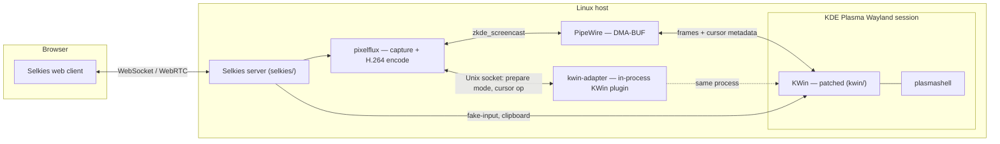

# RakkoRD

*[中文版](README.zh-CN.md)*

A remote desktop built on KDE Plasma Wayland and [Selkies](https://github.com/selkies-project/selkies):
capture a real KWin session over PipeWire/DMA-BUF, encode it with
hardware H.264, and stream it to a browser with low latency. This
repository is the whole stack — patched compositor, capture backend,
streaming server and web client, and the deployment scripts to run all
of it — as a single monorepo.

## What this is

- A KWin plugin (`kwin-adapter/`) and a small set of KWin patches
  (`kwin/`) that let a virtual Wayland output resize on demand and
  suppress its own software cursor per output.
- A capture/encode backend (`pixelflux/`) that turns that output into
  DMA-BUF frames and hardware H.264, including a dedicated channel for
  cursor shape metadata instead of baking the cursor into video.
- A streaming server and web client (`selkies/`), extended with
  DPI-aware input coordinate mapping and adaptive frame dropping under
  WebSocket backpressure.
- Deployment scripts, systemd units, and a Docker Compose alternative to
  run the whole thing (`scripts/`, `systemd/`, `config/`, `desktop/`,
  `deploy/`).

## Architecture

See [`docs/design/`](docs/design/) for how each of these pieces actually
works: [capture pipeline](docs/design/capture-pipeline.md),
[cursor pipeline](docs/design/cursor-pipeline.md),
[HiDPI and input geometry](docs/design/hidpi-and-input.md), and
[adaptive frame dropping](docs/design/adaptive-streaming.md).

## Components

| Path | What | Upstream |
|---|---|---|
| `kwin/` | Patched KWin (Wayland compositor) | [KDE KWin](https://invent.kde.org/plasma/kwin) `v6.3.6` |
| `kwin-adapter/` | In-process KWin plugin: dynamic output modes + cursor suppression over a local Unix socket | Original |
| `pixelflux/` | Screen capture + hardware encoder | [pixelflux](https://github.com/selkies-project/pixelflux) `v2.1.0rc0` |
| `selkies/` | Streaming server, web client, dashboards | [Selkies](https://github.com/selkies-project/selkies) `v2.0.0rc0` |
| `scripts/`, `systemd/`, `config/`, `desktop/` | Native-host deployment: session launcher, systemd units, env template, launcher entries | Original |
| `deploy/remote-desktop/` | Alternative containerized deployment (official Selkies image, no KWin patch needed) | Original |
| `docs/` | Design docs, deployment guide, known limitations | Original |

Exact upstream revisions are pinned in [`source-revisions.env`](source-revisions.env).

## What I changed on top of upstream

Everything below is measured against the unmodified upstream sources at
the revisions pinned in [`source-revisions.env`](source-revisions.env),
restricted to each upstream directory — i.e. it's actual `git diff` output,
not a summary of intentions:

| Directory | Files touched | Lines |
|---|---|---|
| `kwin/` | 3 | +36 / −2 |
| `pixelflux/` | 7 | +819 / −27 |
| `selkies/` | 49 | +3353 / −1726 |

The changes fall into four themes:

1. **Dual-cursor capture** ([design doc](docs/design/cursor-pipeline.md)).
   `zkde_screencast`'s pointer mode switched from baking the cursor into
   video to a metadata channel (`pixelflux/pixelflux/src/wayland/host_cursor.rs`,
   new); KWin gained a per-output "suppress the software cursor layer"
   flag decoupled from `Cursors::isCursorHidden()`
   (`kwin/src/core/output.{h,cpp}`, `kwin/src/compositor_wayland.cpp`);
   `kwin-adapter` exposes the toggle over its existing socket protocol;
   Selkies (`selkies/src/selkies/host_cursor.py`, new) reconciles client
   toggles, the WebRTC pipeline, and capture start/stop into one
   idempotent state.
2. **HiDPI and input geometry** ([design doc](docs/design/hidpi-and-input.md)).
   Split what used to be one coupled "HiDPI" toggle into two independent
   settings — the remote desktop's own DPI (`scaling_dpi`) and the
   framebuffer's size relative to the browser window (`render_scale`) —
   and fixed a coordinate-space bug where the KWin host-capture path sent
   framebuffer-space pointer/touch coordinates to an API that expects
   logical coordinates, causing a scale-proportional offset whenever DPI
   was raised.
3. **Adaptive frame dropping** ([design doc](docs/design/adaptive-streaming.md)).
   The WebSocket video relay (`selkies/src/selkies/selkies.py`,
   `_VideoRelay`) gained a hysteresis-based state machine that drops
   stale, whole video-frame groups under sustained backpressure instead
   of letting one slow client's backlog add latency for everyone.
4. **Rebranding.** Product name, PWA metadata, and icons
   (`selkies/addons/selkies-dashboard/`, `selkies/addons/selkies-dashboard-wish/`)
   were swapped from Selkies' own branding to this project's.

## Deployment

See [`docs/deploy/README.md`](docs/deploy/README.md) for both supported
paths — a native host session with the patched KWin, or a containerized
deployment with the stock `selkies-egl-desktop` image and no host patches
at all.

Building the patched KWin, `kwin-adapter`, and `pixelflux` is Linux-only
(Wayland, PipeWire, VAAPI) and wasn't exercised as part of preparing this
repository, which was done on macOS — see the Development section below.
[`kwin-adapter/README.md`](kwin-adapter/README.md) has its exact `cmake`
invocation as a subdirectory of a KWin 6.3.6 build tree; `pixelflux/` and
`selkies/` each build with their own standard toolchain (Cargo, and
Python + the web core's own `npm`-based build under `selkies/scripts/ci/`,
respectively).

Known gaps between "runs on the author's machine" and "runs anywhere" are
listed in [`docs/known-limitations.md`](docs/known-limitations.md) —
mainly a handful of hardcoded deployment-user paths that were never
generalized.

## License

- `kwin/` — see [`kwin/LICENSES/`](kwin/LICENSES/) (GPL-2.0-or-later and
  related KDE licenses, tagged per file).
- `selkies/` and `pixelflux/` — MPL-2.0 (`selkies/LICENSE`,
  `pixelflux/LICENSE`).
- Everything else, including `kwin-adapter/` — GPL-2.0-or-later
  ([`LICENSE`](LICENSE)).

Full breakdown in [`LICENSING.md`](LICENSING.md).

## Development

This project was built under my direction with the help of AI coding
assistants; every change was reviewed and directed by me rather than
applied unread.
