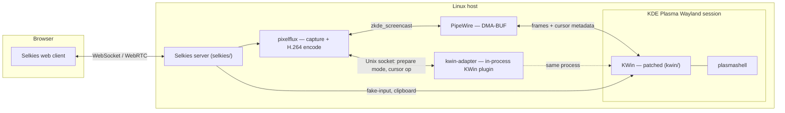

# RakkoRD

*[中文版](README.zh-CN.md)*

A remote desktop built on KDE Plasma Wayland and [Selkies](https://github.com/selkies-project/selkies):
capture a real KWin session over PipeWire/DMA-BUF, encode it with
hardware H.264, and stream it to a browser with low latency. This
repository is the whole stack — patched compositor, capture backend,
streaming server and web client, and the deployment scripts to run all
of it — as a single monorepo.

## What this is

- A KWin plugin (`kwin-adapter/`) and a small set of KWin patches
  (`kwin/`) that let a virtual Wayland output resize on demand and
  suppress its own software cursor per output.
- A capture/encode backend (`pixelflux/`) that turns that output into
  DMA-BUF frames and hardware H.264, including a dedicated channel for
  cursor shape metadata instead of baking the cursor into video.
- A streaming server and web client (`selkies/`), extended with
  DPI-aware input coordinate mapping, adaptive frame dropping and
  delay-driven bitrate control under WebSocket backpressure, smooth
  scrolling, and an IME caret relay.
- A small Sunshine/Moonlight side path (`sunshine/`) whose input reaches
  the same KWin session through `org_kde_kwin_fake_input`.
- Deployment tooling driven by one manifest (`deploy/manifest.tsv`):
  install, daily drift check, and versioned KWin/Selkies releases with
  rollback, plus systemd units and a Docker Compose alternative
  (`scripts/`, `systemd/`, `config/`, `desktop/`, `system/`, `deploy/`).

## Architecture

See [`docs/design/`](docs/design/) for how each of these pieces actually
works: [capture pipeline](docs/design/capture-pipeline.md),
[cursor pipeline](docs/design/cursor-pipeline.md),
[HiDPI and input geometry](docs/design/hidpi-and-input.md), and
[adaptive frame dropping](docs/design/adaptive-streaming.md).

## Components

| Path | What | Upstream |
|---|---|---|
| `kwin/` | Patched KWin (Wayland compositor) | [KDE KWin](https://invent.kde.org/plasma/kwin) `v6.3.6` |
| `kwin-adapter/` | In-process KWin plugin: dynamic output modes + cursor suppression over a local Unix socket | Original |
| `pixelflux/` | Screen capture + hardware encoder | [pixelflux](https://github.com/selkies-project/pixelflux) `v2.1.0rc0` |
| `selkies/` | Streaming server, web client, dashboards | [Selkies](https://github.com/selkies-project/selkies) `v2.0.0rc0` |
| `scripts/`, `systemd/`, `config/`, `desktop/` | Native-host deployment: session launcher, systemd units, env template, launcher entries, build/deploy/drift-check scripts | Original |
| `system/` | Root-owned host files (udev rule, nftables fragment, GPU mode switch) installed from the manifest | Original |
| `sunshine/` | Sunshine/Moonlight side path: evdev → KWin `fake_input` input bridge (C), session prep scripts, units | Original |
| `deploy/manifest.tsv` | Repo file → host path contract shared by `deploy-host.sh` and the drift check | Original |
| `deploy/remote-desktop/` | Alternative containerized deployment (official Selkies image, no KWin patch needed) | Original |
| `docs/` | Design docs, deployment guide, known limitations | Original |

Exact upstream revisions are pinned in [`source-revisions.env`](source-revisions.env).

## What I changed on top of upstream

Everything below is measured against the unmodified upstream sources at
the revisions pinned in [`source-revisions.env`](source-revisions.env),
restricted to each upstream directory — i.e. it's actual `git diff` output,
not a summary of intentions:

| Directory | Files touched | Lines |
|---|---|---|
| `kwin/` | 5 | +87 / −10 |
| `pixelflux/` | 13 | +1565 / −43 |
| `selkies/` | 70 | +9139 / −2031 |

The `selkies/` count includes its new unit tests and browser audit
scripts under `selkies/tests/`.

The changes fall into these themes:

1. **Dual-cursor capture** ([design doc](docs/design/cursor-pipeline.md)).
   `zkde_screencast`'s pointer mode switched from baking the cursor into
   video to a metadata channel (`pixelflux/pixelflux/src/wayland/host_cursor.rs`,
   new); KWin gained a per-output "suppress the software cursor layer"
   flag decoupled from `Cursors::isCursorHidden()`
   (`kwin/src/core/output.{h,cpp}`, `kwin/src/compositor_wayland.cpp`);
   `kwin-adapter` exposes the toggle over its existing socket protocol;
   Selkies (`selkies/src/selkies/host_cursor.py`, new) reconciles client
   toggles, the WebRTC pipeline, and capture start/stop into one
   idempotent state. Later fixes: in metadata mode KWin's screencast
   recorded a separate cursor-only buffer for every pointer move, which
   competed with real repaints for KWin's three buffers and dropped
   frames while dragging windows; with `KWIN_SCREENCAST_CURSOR_SHAPE_ONLY=1`
   it now emits a cursor-only frame only when the shape changes and
   pixelflux asks for four buffers
   (`kwin/src/plugins/screencast/screencaststream.cpp`). The screencast
   metadata also takes the hotspot and the bitmap from the same cursor
   image, so a shape change can no longer pair a new hotspot with the old
   picture.
2. **HiDPI and input geometry** ([design doc](docs/design/hidpi-and-input.md)).
   Split what used to be one coupled "HiDPI" toggle into two independent
   settings — the remote desktop's own DPI (`scaling_dpi`) and the
   framebuffer's size relative to the browser window (`render_scale`) —
   and fixed a coordinate-space bug where the KWin host-capture path sent
   framebuffer-space pointer/touch coordinates to an API that expects
   logical coordinates, causing a scale-proportional offset whenever DPI
   was raised.
3. **Adaptive frame dropping and bitrate** ([design doc](docs/design/adaptive-streaming.md)).
   The WebSocket video relay (`selkies/src/selkies/selkies.py`,
   `_VideoRelay`) gained a hysteresis-based state machine that drops
   stale, whole video-frame groups under sustained backpressure instead
   of letting one slow client's backlog add latency for everyone.
   On top of that, `selkies/src/selkies/adaptive_bitrate.py` (new) reads
   the queueing delay from frame acks and switches the encoder from
   constant quality to a capped bitrate only while a queue persists. Two
   false triggers seen in production were fixed: the ack gap after a
   background tab comes back, and client keyframe requests / reconnects,
   which looked like congestion but were resyncs.
4. **Input.** Wheel and touchpad scrolling send fractional axis deltas
   (`ws,<dx>,<dy>`), eased per frame on the client, instead of whole
   clicks every 100 ms; KWin `fake_input` takes `wl_fixed` axis values, so
   only X11/uinput still rounds to clicks. `scripts/rakkord-imecaret.py`
   learns the focused Qt app's caret rectangle over the fcitx D-Bus portal
   and `selkies/src/selkies/ime_caret.py` relays it, so the browser's IME
   candidate window follows the remote text cursor. Touch gestures and
   native touch passthrough for tablets live in
   `selkies/addons/selkies-web-core/lib/touch-*.js`.
5. **Rebranding.** Product name, PWA metadata, and icons
   (`selkies/addons/selkies-dashboard/`, `selkies/addons/selkies-dashboard-wish/`)
   were swapped from Selkies' own branding to this project's.

## Engineering highlights

- **Frame drops while dragging windows.** Per-second counters at each
  stage showed KWin delivering 4–16 real frames/s next to 20–40
  cursor-only frames/s; cursor-only frames were taking the screencast
  buffers that repaints needed. Emitting them only on shape changes and
  raising the buffer count brought a sandboxed drag back to ~60 fps;
  neither change alone did.
- **Cursor drawn by the browser, not baked into video.** The cursor shape
  travels as metadata and KWin stops drawing its software cursor on the
  captured output only, so the local cursor stays responsive and doesn't
  double up.
- **Cursor hotspot/bitmap mismatch.** A one-frame mismatch made the
  cursor jump for ~300 ms when entering a text field; hotspot and bitmap
  now come from one cursor image and are only sent as a pair.
- **Bitrate control that ignores fake congestion.** The controller works
  from ack-measured queueing delay, and treats tab-resume gaps and client
  resyncs as such instead of cutting bitrate to the floor.
- **Smooth scrolling.** Fractional axis deltas plus client-side easing
  replace integer wheel clicks, using the `wl_fixed` precision KWin's
  `fake_input` already accepts.
- **Encode on the GPU that renders.** `scripts/selkies-dri-exec.sh`
  resolves the render node KWin actually opened (Intel VAAPI or NVIDIA
  NVENC) and gives the same node to the encoder, because a cross-GPU
  DMA-BUF path cannot take the zero-copy encoder.
- **Moonlight input into a virtual KWin session.** `kwin_wayland
  --virtual` opens no input devices, so Sunshine's uinput events never
  arrive; `sunshine/input-bridge/` reads them and replays them through
  KWin's privileged `fake_input` protocol.
- **Deployment as a contract.** `deploy/manifest.tsv` lists every file
  that lands on the host; `scripts/deploy-host.sh` installs from it
  (dry-run by default, backups on `--apply`), a daily timer runs
  `scripts/check-drift.sh` against it, and KWin/Selkies are built into
  timestamped releases with a `current` symlink for rollback.

All of this is modification and integration work on top of Selkies,
pixelflux and KWin; the capture, encode and streaming foundations are
theirs.

## Deployment

See [`docs/deploy/README.md`](docs/deploy/README.md) for both supported
paths — a native host session with the patched KWin, or a containerized
deployment with the stock `selkies-egl-desktop` image and no host patches
at all.

Building the patched KWin, `kwin-adapter`, and `pixelflux` is Linux-only
(Wayland, PipeWire, VAAPI/NVENC). `scripts/build-kwin.sh` and
`scripts/build-release.sh` are what the author's host uses to build them
into versioned releases; they haven't been tried on another distro.
[`kwin-adapter/README.md`](kwin-adapter/README.md) has its exact `cmake`
invocation as a subdirectory of a KWin 6.3.6 build tree; `pixelflux/` and
`selkies/` each build with their own standard toolchain (Cargo, and
Python + the web core's own `npm`-based build under `selkies/scripts/ci/`,
respectively).

Known gaps between "runs on the author's machine" and "runs anywhere" are
listed in [`docs/known-limitations.md`](docs/known-limitations.md).

## License

- `kwin/` — see [`kwin/LICENSES/`](kwin/LICENSES/) (GPL-2.0-or-later and
  related KDE licenses, tagged per file).
- `selkies/` and `pixelflux/` — MPL-2.0 (`selkies/LICENSE`,
  `pixelflux/LICENSE`).
- `sunshine/input-bridge/` — MIT for the bridge's own C sources (SPDX
  tags in each file); the generated Wayland protocol files next to them
  keep their upstream licenses.
- Everything else, including `kwin-adapter/` — GPL-2.0-or-later
  ([`LICENSE`](LICENSE)).

Full breakdown in [`LICENSING.md`](LICENSING.md).

## Development

This project was built under my direction with the help of AI coding
assistants; every change was reviewed and directed by me rather than
applied unread.
