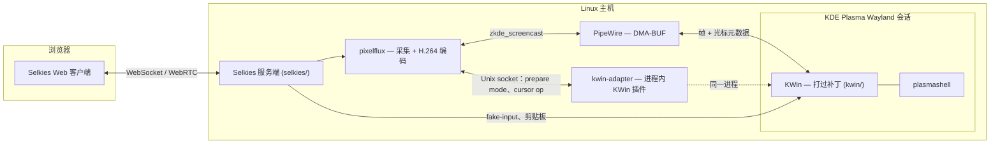

# Muelsyse

*[English](README.md)*

一个基于 KDE Plasma Wayland 与 [Selkies](https://github.com/selkies-project/selkies)
的远程桌面：通过 PipeWire/DMA-BUF 捕获真实的 KWin 会话，用硬件 H.264 编码，
以低延迟推流到浏览器。整个技术栈——打过补丁的 compositor、采集后端、推流
服务端与 Web 客户端，以及运行它们所需的部署脚本——都在这一个 monorepo 里。

## 这是什么

- 一个 KWin 插件（`kwin-adapter/`）加一小组 KWin 补丁（`kwin/`），让虚拟
  Wayland 输出可以按需调整分辨率，并按输出单独抑制它自带的软件光标层。
- 一个采集/编码后端（`pixelflux/`），把该输出转成 DMA-BUF 帧与硬件 H.264，
  并为光标形状开了一条独立的元数据通道，而不是把光标烧进视频画面。
- 一个推流服务端与 Web 客户端（`selkies/`），在此基础上加了感知 DPI 的
  输入坐标映射、WebSocket 背压下的自适应丢帧与按延迟调节的码率控制、
  平滑滚动，以及输入法光标位置转发。
- 一条 Sunshine/Moonlight 旁路（`sunshine/`），它的输入经
  `org_kde_kwin_fake_input` 进入同一个 KWin 会话。
- 由一份清单（`deploy/manifest.tsv`）驱动的部署工具：安装、每日漂移检查、
  带回滚的版本化 KWin/Selkies release，外加 systemd unit 和一套 Docker
  Compose 替代部署（`scripts/`、`systemd/`、`config/`、`desktop/`、`system/`、`deploy/`）。

## 架构

各部分具体怎么工作见 [`docs/design/`](docs/design/)（英文）：
[capture pipeline](docs/design/capture-pipeline.md)、
[cursor pipeline](docs/design/cursor-pipeline.md)、
[HiDPI and input geometry](docs/design/hidpi-and-input.md)、
[adaptive frame dropping](docs/design/adaptive-streaming.md)。

## 组成部分

| 路径 | 内容 | 来源 |
|---|---|---|
| `kwin/` | 打过补丁的 KWin（Wayland compositor） | [KDE KWin](https://invent.kde.org/plasma/kwin) `v6.3.6` |
| `kwin-adapter/` | 进程内 KWin 插件：动态输出模式 + 通过本地 Unix socket 抑制光标 | 原创 |
| `pixelflux/` | 屏幕采集 + 硬件编码 | [pixelflux](https://github.com/selkies-project/pixelflux) `v2.1.0rc0` |
| `selkies/` | 推流服务端、Web 客户端、dashboard | [Selkies](https://github.com/selkies-project/selkies) `v2.0.0rc0` |
| `scripts/`、`systemd/`、`config/`、`desktop/` | 原生主机部署：会话启动脚本、systemd unit、环境变量模板、launcher 条目、构建/部署/漂移检查脚本 | 原创 |
| `system/` | 需要 root 的主机文件（udev 规则、nftables 片段、GPU 模式切换），按清单安装 | 原创 |
| `sunshine/` | Sunshine/Moonlight 旁路：evdev → KWin `fake_input` 的输入桥（C）、会话准备脚本、unit | 原创 |
| `deploy/manifest.tsv` | 仓库文件 → 主机路径的契约，`deploy-host.sh` 和漂移检查共用 | 原创 |
| `deploy/remote-desktop/` | 另一种容器化部署方式（官方 Selkies 镜像，无需 KWin 补丁） | 原创 |
| `docs/` | 设计文档、部署指南、已知限制 | 原创 |

上游具体版本钉在 [`source-revisions.env`](source-revisions.env)。

## 相对上游改了什么

以下数字都是相对 [`source-revisions.env`](source-revisions.env) 钉住的未修改上游源码，
按每个上游目录分别测出来的——是实打实的 `git diff` 结果，不是意图总结：

| 目录 | 改动文件数 | 行数 |
|---|---|---|
| `kwin/` | 5 | +87 / −10 |
| `pixelflux/` | 13 | +1565 / −43 |
| `selkies/` | 70 | +9139 / −2031 |

`selkies/` 的数字包含 `selkies/tests/` 下新增的单元测试和浏览器审计脚本。

改动大致分几类：

1. **双光标采集**（[设计文档](docs/design/cursor-pipeline.md)）。
   `zkde_screencast` 的指针模式从把光标烧进视频改成走一条元数据通道
   （`pixelflux/pixelflux/src/wayland/host_cursor.rs`，新增）；KWin 新增了
   一个与 `Cursors::isCursorHidden()` 解耦的、按输出单独生效的"抑制软件
   光标层"开关（`kwin/src/core/output.{h,cpp}`、`kwin/src/compositor_wayland.cpp`）；
   `kwin-adapter` 通过既有的 socket 协议把这个开关暴露出去；Selkies
   （`selkies/src/selkies/host_cursor.py`，新增）把客户端切换、WebRTC 管线、
   采集启停这几个独立触发源归并成一个幂等的状态。之后的修复：元数据模式下
   KWin 录屏每次指针移动都单独录一个仅光标 buffer，和真正的重绘抢 KWin 仅有
   的 3 个 buffer，拖窗口时整帧被丢；设 `KWIN_SCREENCAST_CURSOR_SHAPE_ONLY=1`
   后只在光标形状变化时单独成帧，pixelflux 也改为申请 4 个 buffer
   （`kwin/src/plugins/screencast/screencaststream.cpp`）。录屏元数据里的
   hotspot 和位图也改为出自同一张光标图，形状切换时不会再出现新 hotspot
   配旧图。
2. **HiDPI 与输入几何**（[设计文档](docs/design/hidpi-and-input.md)）。
   把原来耦合在一起的单一"HiDPI"开关拆成两个互不相关的设置——远程桌面
   自己的 DPI（`scaling_dpi`）与相对浏览器窗口的帧缓冲尺寸（`render_scale`）
   ——并修掉了一处坐标空间错误：KWin host-capture 路径把帧缓冲空间的
   指针/触摸坐标直接发给了一个期望逻辑坐标的 API，导致 `scaling_dpi`
   调高后出现与缩放比例成正比的偏移。
3. **自适应丢帧与码率**（[设计文档](docs/design/adaptive-streaming.md)）。
   WebSocket 视频中继（`selkies/src/selkies/selkies.py` 的 `_VideoRelay`）
   新增了一个基于滞回（hysteresis）的状态机，在持续背压下按完整的视频帧组
   丢弃陈旧数据，而不是让某一个慢客户端的积压拖慢所有人的延迟。
   在此之上，`selkies/src/selkies/adaptive_bitrate.py`（新增）从帧 ack 算出
   排队延迟，只在排队持续存在时把编码器从恒定质量切到限码率。修掉了生产上
   见到的两种误判：后台标签页切回时的 ack 断流，以及客户端请求关键帧/重连
   ——它们看起来像拥塞，其实是重新同步。
4. **输入。** 滚轮和触控板改发小数轴增量（`ws,<dx>,<dy>`），由客户端按帧
   缓动，不再每 100 ms 发一次整格；KWin `fake_input` 本来就收 `wl_fixed`，
   只有 X11/uinput 仍按整格。`scripts/muelsyse-imecaret.py` 经 fcitx D-Bus
   portal 拿到当前 Qt app 的光标矩形，`selkies/src/selkies/ime_caret.py`
   转发给浏览器，输入法候选框因此跟着远程文字光标走。平板的触控手势与原生
   触摸直通在 `selkies/addons/selkies-web-core/lib/touch-*.js`。
5. **换皮。** 产品名、PWA 元数据、图标
   （`selkies/addons/selkies-dashboard/`、`selkies/addons/selkies-dashboard-wish/`）
   从 Selkies 自己的品牌换成了本项目的。

## 工程要点

- **拖窗口掉帧。** 按阶段逐秒计数发现 KWin 每秒只出 4–16 个真帧，同时有
  20–40 个仅光标帧；仅光标帧占住了重绘要用的录屏 buffer。改为只在形状变化
  时单独成帧、并加大 buffer 数之后，沙箱里拖窗口回到约 60 fps；两处只改
  一处都不够。
- **光标由浏览器画，不烧进视频。** 光标形状走元数据，KWin 只在被采集的输出
  上停画软件光标，本地光标跟手，也不会出现两个光标。
- **光标 hotspot 与位图错配。** 一帧的错配让光标进文本框时跳约 300 ms；
  现在 hotspot 和位图出自同一张光标图，只成对下发。
- **不被假拥塞骗的码率控制。** 控制器看 ack 测出的排队延迟，标签页切回的
  断流和客户端重同步按各自的情况处理，不再把码率压到下限。
- **平滑滚动。** 用小数轴增量加客户端缓动取代整格滚轮，用上 KWin
  `fake_input` 本来就支持的 `wl_fixed` 精度。
- **在渲染的那张卡上编码。** `scripts/selkies-dri-exec.sh` 找出 KWin 实际
  打开的 render 节点（Intel VAAPI 或 NVIDIA NVENC），把同一个节点交给编码器，
  因为跨卡的 DMA-BUF 走不了零拷贝编码。
- **Moonlight 输入进虚拟 KWin 会话。** `kwin_wayland --virtual` 不打开任何
  输入设备，Sunshine 的 uinput 事件到不了；`sunshine/input-bridge/` 读这些
  事件，经 KWin 的特权协议 `fake_input` 重放。
- **部署即契约。** `deploy/manifest.tsv` 列出所有装到主机上的文件；
  `scripts/deploy-host.sh` 按它安装（默认 dry-run，`--apply` 时先备份），
  每日定时器按它跑 `scripts/check-drift.sh`，KWin/Selkies 编成带时间戳的
  release，用 `current` 软链切换和回滚。

以上都是在 Selkies、pixelflux 和 KWin 之上的改造与集成；采集、编码、推流的
基础是它们的。

## 部署

两条支持路径的完整说明见 [`docs/deploy/README.md`](docs/deploy/README.md)
（英文）——原生主机会话（打补丁的 KWin），或不需要任何主机补丁的容器化部署。

编译打过补丁的 KWin、`kwin-adapter` 与 `pixelflux` 只能在 Linux 上进行
（依赖 Wayland、PipeWire、VAAPI/NVENC）。`scripts/build-kwin.sh` 和
`scripts/build-release.sh` 是作者主机上把它们编成版本化 release 的脚本，
没在别的发行版上试过。[`kwin-adapter/README.md`](kwin-adapter/README.md)
给出了它作为 KWin 6.3.6 构建树子目录的确切 `cmake` 调用方式；`pixelflux/`
与 `selkies/` 各自用自己标准的工具链构建（Cargo，以及 Python + Web core
自带的、基于 `npm` 的构建，位于 `selkies/scripts/ci/` 下）。

"能在作者自己机器上跑"与"到哪都能跑"之间的已知差距记录在
[`docs/known-limitations.md`](docs/known-limitations.md)（英文）。

## License

- `kwin/` — 见 [`kwin/LICENSES/`](kwin/LICENSES/)（GPL-2.0-or-later 及相关
  KDE 许可证，按文件逐一标注）。
- `selkies/` 与 `pixelflux/` — MPL-2.0（`selkies/LICENSE`、`pixelflux/LICENSE`）。
- `sunshine/input-bridge/` — 输入桥自己的 C 源码为 MIT（每个文件有 SPDX
  标注）；旁边生成的 Wayland 协议文件沿用上游许可证。
- 其余部分，包括 `kwin-adapter/` — GPL-2.0-or-later（[`LICENSE`](LICENSE)）。

完整拆解见 [`LICENSING.md`](LICENSING.md)。

## Development

构建、测试与部署命令见 [`docs/development.md`](docs/development.md)。

这个项目是在我主导下、借助 AI 编码助手开发的，每一处改动都经过我审阅和把控，
而非未经查看直接采纳。
