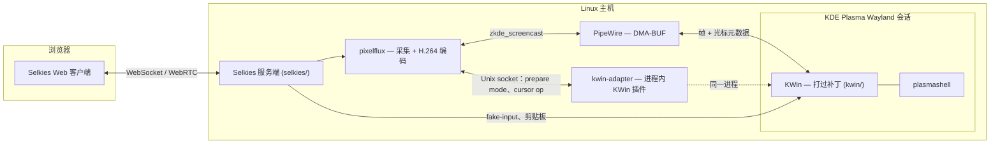

# RakkoRD

*[English](README.md)*

一个基于 KDE Plasma Wayland 与 [Selkies](https://github.com/selkies-project/selkies)
的远程桌面：通过 PipeWire/DMA-BUF 捕获真实的 KWin 会话，用硬件 H.264 编码，
以低延迟推流到浏览器。整个技术栈——打过补丁的 compositor、采集后端、推流
服务端与 Web 客户端，以及运行它们所需的部署脚本——都在这一个 monorepo 里。

## 这是什么

- 一个 KWin 插件（`kwin-adapter/`）加一小组 KWin 补丁（`kwin/`），让虚拟
  Wayland 输出可以按需调整分辨率，并按输出单独抑制它自带的软件光标层。
- 一个采集/编码后端（`pixelflux/`），把该输出转成 DMA-BUF 帧与硬件 H.264，
  并为光标形状开了一条独立的元数据通道，而不是把光标烧进视频画面。
- 一个推流服务端与 Web 客户端（`selkies/`），在此基础上加了感知 DPI 的
  输入坐标映射，以及 WebSocket 背压下的自适应丢帧。
- 部署脚本、systemd unit，以及一套 Docker Compose 的替代部署方式，
  用来运行整套系统（`scripts/`、`systemd/`、`config/`、`desktop/`、`deploy/`）。

## 架构

各部分具体怎么工作见 [`docs/design/`](docs/design/)（英文）：
[capture pipeline](docs/design/capture-pipeline.md)、
[cursor pipeline](docs/design/cursor-pipeline.md)、
[HiDPI and input geometry](docs/design/hidpi-and-input.md)、
[adaptive frame dropping](docs/design/adaptive-streaming.md)。

## 组成部分

| 路径 | 内容 | 来源 |
|---|---|---|
| `kwin/` | 打过补丁的 KWin（Wayland compositor） | [KDE KWin](https://invent.kde.org/plasma/kwin) `v6.3.6` |
| `kwin-adapter/` | 进程内 KWin 插件：动态输出模式 + 通过本地 Unix socket 抑制光标 | 原创 |
| `pixelflux/` | 屏幕采集 + 硬件编码 | [pixelflux](https://github.com/selkies-project/pixelflux) `v2.1.0rc0` |
| `selkies/` | 推流服务端、Web 客户端、dashboard | [Selkies](https://github.com/selkies-project/selkies) `v2.0.0rc0` |
| `scripts/`、`systemd/`、`config/`、`desktop/` | 原生主机部署：会话启动脚本、systemd unit、环境变量模板、launcher 条目 | 原创 |
| `deploy/remote-desktop/` | 另一种容器化部署方式（官方 Selkies 镜像，无需 KWin 补丁） | 原创 |
| `docs/` | 设计文档、部署指南、已知限制 | 原创 |

上游具体版本钉在 [`source-revisions.env`](source-revisions.env)。

## 相对上游改了什么

以下数字都是相对 [`source-revisions.env`](source-revisions.env) 钉住的未修改上游源码，
按每个上游目录分别测出来的——是实打实的 `git diff` 结果，不是意图总结：

| 目录 | 改动文件数 | 行数 |
|---|---|---|
| `kwin/` | 3 | +36 / −2 |
| `pixelflux/` | 7 | +819 / −27 |
| `selkies/` | 49 | +3353 / −1726 |

改动大致分四类：

1. **双光标采集**（[设计文档](docs/design/cursor-pipeline.md)）。
   `zkde_screencast` 的指针模式从把光标烧进视频改成走一条元数据通道
   （`pixelflux/pixelflux/src/wayland/host_cursor.rs`，新增）；KWin 新增了
   一个与 `Cursors::isCursorHidden()` 解耦的、按输出单独生效的"抑制软件
   光标层"开关（`kwin/src/core/output.{h,cpp}`、`kwin/src/compositor_wayland.cpp`）；
   `kwin-adapter` 通过既有的 socket 协议把这个开关暴露出去；Selkies
   （`selkies/src/selkies/host_cursor.py`，新增）把客户端切换、WebRTC 管线、
   采集启停这几个独立触发源归并成一个幂等的状态。
2. **HiDPI 与输入几何**（[设计文档](docs/design/hidpi-and-input.md)）。
   把原来耦合在一起的单一"HiDPI"开关拆成两个互不相关的设置——远程桌面
   自己的 DPI（`scaling_dpi`）与相对浏览器窗口的帧缓冲尺寸（`render_scale`）
   ——并修掉了一处坐标空间错误：KWin host-capture 路径把帧缓冲空间的
   指针/触摸坐标直接发给了一个期望逻辑坐标的 API，导致 `scaling_dpi`
   调高后出现与缩放比例成正比的偏移。
3. **自适应丢帧**（[设计文档](docs/design/adaptive-streaming.md)）。
   WebSocket 视频中继（`selkies/src/selkies/selkies.py` 的 `_VideoRelay`）
   新增了一个基于滞回（hysteresis）的状态机，在持续背压下按完整的视频帧组
   丢弃陈旧数据，而不是让某一个慢客户端的积压拖慢所有人的延迟。
4. **换皮。** 产品名、PWA 元数据、图标
   （`selkies/addons/selkies-dashboard/`、`selkies/addons/selkies-dashboard-wish/`）
   从 Selkies 自己的品牌换成了本项目的。

## 部署

两条支持路径的完整说明见 [`docs/deploy/README.md`](docs/deploy/README.md)
（英文）——原生主机会话（打补丁的 KWin），或不需要任何主机补丁的容器化部署。

编译打过补丁的 KWin、`kwin-adapter` 与 `pixelflux` 只能在 Linux 上进行
（依赖 Wayland、PipeWire、VAAPI），这次整理仓库的过程（在 macOS 上完成）
没有验证编译——见下面的 Development 一节。[`kwin-adapter/README.md`](kwin-adapter/README.md)
给出了它作为 KWin 6.3.6 构建树子目录的确切 `cmake` 调用方式；`pixelflux/`
与 `selkies/` 各自用自己标准的工具链构建（Cargo，以及 Python + Web core
自带的、基于 `npm` 的构建，位于 `selkies/scripts/ci/` 下）。

"能在作者自己机器上跑"与"到哪都能跑"之间的已知差距记录在
[`docs/known-limitations.md`](docs/known-limitations.md)（英文）——主要是
几处从未泛化过的、写死的部署用户路径。

## License

- `kwin/` — 见 [`kwin/LICENSES/`](kwin/LICENSES/)（GPL-2.0-or-later 及相关
  KDE 许可证，按文件逐一标注）。
- `selkies/` 与 `pixelflux/` — MPL-2.0（`selkies/LICENSE`、`pixelflux/LICENSE`）。
- 其余部分，包括 `kwin-adapter/` — GPL-2.0-or-later（[`LICENSE`](LICENSE)）。

完整拆解见 [`LICENSING.md`](LICENSING.md)。

## Development

这个项目是在我主导下、借助 AI 编码助手开发的，每一处改动都经过我审阅和把控，
而非未经查看直接采纳。
